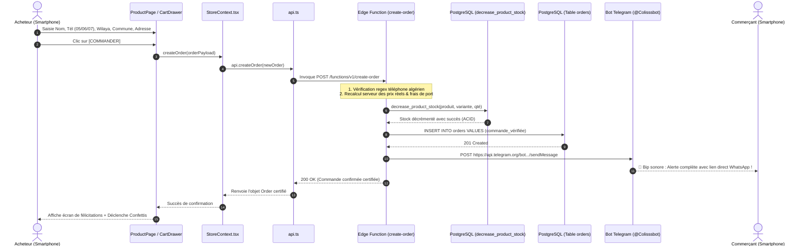

# AUDIT TECHNIQUE COMPLET & ARCHITECTURE DU SYSTÈME — MAISON CÉLESTE V2

> **Auteur :** Architecte Logiciel Senior (Full Stack, DevOps & Cybersécurité)  
> **Projet :** Maison Céleste V2 (Haute Joaillerie & Prêt-à-Porter • E-Commerce Cash on Delivery Algérie)  
> **Dépôt GitHub :** [mouhcenkeffous813/maison-celeste-v2](https://github.com/mouhcenkeffous813/maison-celeste-v2)  
> **Production :** [maison-celeste-v2.vercel.app](https://maison-celeste-v2.vercel.app)  
> **Base de Données Cloud & Auth :** Supabase PostgreSQL (`omzqajugkhkjxlkfmxpo.supabase.co`)  
> **Moteur Serverless :** Supabase Edge Functions (Deno / TypeScript)  
> **Date du Rapport :** 14 Novembre 2026 (Version 2.0 — Architecture Hybride BaaS + Serverless)  

---

## SOMMAIRE

1. [PARTIE 1 — Analyse du Projet & Arborescence Réelle V2](#partie-1--analyse-du-projet--arborescence-réelle-v2)
2. [PARTIE 2 — Frontend (Interface Utilisateur & Expérience Client)](#partie-2--frontend-interface-utilisateur--expérience-client)
3. [PARTIE 3 — Backend (Architecture Hybride BaaS + Serverless Edge Functions)](#partie-3--backend-architecture-hybride-baas--serverless-edge-functions)
4. [PARTIE 4 — Base de Données (PostgreSQL V2, RPC & Supabase Storage)](#partie-4--base-de-données-postgresql-v2-rpc--supabase-storage)
5. [PARTIE 5 — Communication entre Frontend, Edge Functions et Database](#partie-5--communication-entre-frontend-edge-functions-et-database)
6. [PARTIE 6 — Hébergement, CI/CD et DevOps Automatisé](#partie-6--hébergement-cicd-et-devops-automatisé)
7. [PARTIE 7 — Audit de Sécurité V2 & Résolution des Vulnérabilités](#partie-7--audit-de-sécurité-v2--résolution-des-vulnérabilités)
8. [PARTIE 8 — Schéma Global de l'Architecture V2 (Mermaid)](#partie-8--schéma-global-de-larchitecture-v2-mermaid)
9. [PARTIE 9 — Glossaire Technique Détaillé](#partie-9--glossaire-technique-détaillé)
10. [PARTIE 10 — Parcours d'Apprentissage & Guide de Maintenance](#partie-10--parcours-dapprentissage--guide-de-maintenance)

---

# PARTIE 1 — ANALYSE DU PROJET & ARBORESCENCE RÉELLE V2

### 1.1 Modèle Architectural Global V2
Le projet **Maison Céleste V2** implémente une **Architecture Hybride Moderne** alliant :
1. **Frontend SPA (Single Page Application) :** Développée avec **React 18** et **TypeScript**, packagée via **Vite 5**, offrant des transitions ultra-rapides et une expérience fluide inspirée des applications mobiles natives.
2. **Backend as a Service (Supabase Cloud) :** Base de données relationnelle **PostgreSQL 15+**, synchronisation temps réel par WebSockets (`Realtime`), gestion d'identités chiffrée (`Supabase Auth GoTrue`) et stockage de médias distribué sur CDN mondial (`Supabase Storage`).
3. **Couche Serverless (Edge Functions Deno) :** Logique serveur critique déportée dans l'Edge Function `create-order` pour garantir l'intégrité financière (recalcul serveur des prix et des frais de port), la décrémentation atomique des stocks et l'envoi d'alertes instantanées vers le **Bot Telegram officiel commerçant (`@Colisssbot`)**.

### 1.2 Arborescence Complète du Projet V2

```text
maison-celeste-v2/
├── .github/
│   └── workflows/
│       ├── ci.yml                          # Pipeline d'Intégration Continue (TypeScript & Build)
│       └── database-backup.yml             # Sauvegarde automatisée quotidienne de PostgreSQL
├── docs/                                   # Documentation d'architecture et de vente
├── public/                                 # Fichiers statiques servis à la racine
│   ├── images/products/                    # Photographies locales de secours
│   ├── logo-icon.svg                       # Favicon et icône de marque
│   └── orlea-logo.svg                      # Logo vectoriel officiel
├── src/                                    # Code source TypeScript / React
│   ├── components/
│   │   ├── admin/                          # Back-Office Administrateur (Strictement restreint)
│   │   │   ├── AdminLayout.tsx             # Structure générale, sidebar responsive & navigation
│   │   │   ├── AdminLogin.tsx              # Porte d'accès sécurisée par Supabase Auth (Email + Password)
│   │   │   ├── AdminMarketing.tsx          # Gestion des Pixels Meta / TikTok et logs d'événements
│   │   │   ├── AdminOrders.tsx             # CRM des commandes, filtres de statuts, export CSV, suppression
│   │   │   ├── AdminOverview.tsx           # KPIs financiers en direct (Chiffre d'Affaires, Panier moyen)
│   │   │   ├── AdminProducts.tsx           # Gestion des articles, variantes et téléversement d'images
│   │   │   ├── AdminSettings.tsx           # Paramètres White-Label & Configuration Bot Telegram
│   │   │   ├── AdminShipping.tsx           # Grille tarifaire des 58 Wilayas (Domicile & Stop Desk)
│   │   │   ├── NewOrderAlertModal.tsx      # Alerte modale festive avec confettis lors d'une nouvelle commande
│   │   │   ├── OrderDeliverySlip.tsx       # Bordereau de livraison standard au format colis
│   │   │   └── OrderDetailsModal.tsx       # Fiche détaillée de commande avec actions WhatsApp
│   │   └── storefront/                     # Boutique publique (Accessible à tous les clients)
│   │       ├── CartDrawer.tsx              # Tiroir latéral du panier multi-articles & formulaire COD
│   │       ├── CartNotification.tsx        # Toast d'ajout au panier avec choix « Continuer » / « Voir panier »
│   │       ├── ContactPage.tsx             # Formulaire de contact et coordonnées de la marque
│   │       ├── CookieConsentBanner.tsx     # Bannière de conformité RGPD / e-Privacy
│   │       ├── Footer.tsx                  # Pied de page avec lien d'accès discret à l'espace gérant
│   │       ├── HomePage.tsx                # Vitrine, grille produits responsive 2 colonnes mobile, filtres
│   │       ├── Navbar.tsx                  # En-tête client (Logo, Recherche, Thème, Panier)
│   │       ├── NavigationDrawer.tsx        # Menu mobile coulissant
│   │       ├── OrderTracking.tsx           # Module de suivi de commande en direct par numéro de téléphone
│   │       ├── ProductPage.tsx             # Fiche produit haute joaillerie avec sélecteur de variantes
│   │       └── ShippingRates.tsx           # Grille publique des tarifs de livraison des 58 Wilayas
│   ├── config/                             # Données de configuration
│   │   ├── store.config.ts                 # Paramètres par défaut, palettes de couleurs et thèmes
│   │   └── wilayas.json                    # Données administratives des 58 Wilayas et 1 541 communes
│   ├── context/
│   │   └── StoreContext.tsx                # Gestionnaire d'état réactif centralisé (StoreProvider & useStore)
│   ├── data/                               # Données initiales et types de repli
│   │   ├── mockOrders.ts                   # Commandes de démonstration
│   │   ├── mockProducts.ts                 # Catalogue de départ
│   │   └── mockReviews.ts                  # Avis clients vérifiés
│   ├── services/                           # Services d'infrastructure & APIs
│   │   ├── api.ts                          # Abstraction des appels Supabase PostgreSQL et Edge Functions
│   │   ├── consentManager.ts               # Gestion des consentements utilisateurs pour le tracking
│   │   ├── storage.ts                      # Compression WebP HTML5 Canvas & Upload Supabase Storage
│   │   ├── supabaseClient.ts               # Client singleton `@supabase/supabase-js` avec persistance JWT
│   │   ├── telegramService.ts              # Service de notifications directes vers le Bot Telegram
│   │   └── trackingManager.ts              # Orchestration unifiée des Pixels Meta et TikTok
│   ├── types/                              # Interfaces TypeScript strictes du projet
│   │   ├── index.ts                        # Types Product, Order, Wilaya, StoreConfig
│   │   └── marketing.ts                    # Types des événements de tracking publicitaire
│   ├── utils/                              # Fonctions utilitaires pures
│   │   ├── formatters.ts                   # Formatage monétaire (DA), dates et normalisation téléphonique
│   │   └── imageCompressor.ts              # Algorithmes de compression d'images
│   ├── App.tsx                             # Chef d'orchestre de l'application (Routeur SPA)
│   ├── index.css                           # Styles Tailwind CSS et variables CSS dynamiques
│   └── main.tsx                            # Point d'entrée de montage React 18 dans le DOM
├── supabase/                               # Configuration et code serveur Supabase
│   └── functions/
│       └── create-order/
│           └── index.ts                    # Edge Function Serverless Deno (Validation serveur & Telegram)
├── supabase-v2-migration.sql               # Script complet de migration SQL (Tables, Seeds, RPC, Storage, RLS)
├── fix-permissions.sql                     # Script de déblocage et renforcement des politiques RLS
├── package.json                            # Dépendances NPM et scripts de build
├── tailwind.config.js                      # Configuration Tailwind CSS
├── tsconfig.json                           # Configuration du compilateur TypeScript
└── vite.config.ts                          # Configuration du bundler Vite 5
```

---

# PARTIE 2 — FRONTEND (INTERFACE UTILISATEUR & EXPÉRIENCE CLIENT)

### 2.1 Technologies Frontend Détectées
1. **Framework d'Interface :** **React 18** (`react`, `react-dom`).
2. **Langage :** **TypeScript** (`strict: true`), garantissant une sécurité de typage totale sans runtime bugs.
3. **Outil de Construction & Bundler :** **Vite 5**, procurant un Hot Module Replacement (HMR) instantané en développement et une minification Rollup ultra-performante en production.
4. **Système de Design & CSS :** **Tailwind CSS 3.4** avec injection dynamique de variables CSS via `applyThemeVariables()` pour supporter le moteur de thèmes White-Label.
5. **Bibliothèque d'Icônes :** **Lucide React** (icônes vectorielles légères et scalables).
6. **Effets & Animations :** **Canvas-Confetti** pour la célébration festive lors de la confirmation d'achat.

### 2.2 Gestion de l'État Réactif ([`StoreContext.tsx`](file:///c:/Users/Mohcen/Desktop/maison-celeste-v2/src/context/StoreContext.tsx))
L'application n'utilise pas de bibliothèque externe lourde (comme Redux ou Zustand) mais s'appuie sur le **React Context API** couplé à des hooks personnalisés (`useStore()`). Ce choix garantit un bundle minimal (moins de 200 Ko gzippé) tout en offrant une réactivité parfaite.

L'état global pilote :
* La vue active (`home`, `product`, `tracking`, `shipping`, `contact`, `admin`).
* Le catalogue de produits centralisé (`products`) chargé dynamiquement depuis Supabase PostgreSQL.
* Le panier d'achat multi-articles (`cart`), calculant le sous-total et les frais de livraison en direct.
* La session d'authentification de l'administrateur (`isAdminLoggedIn`, `adminUserEmail`), strictement synchronisée avec Supabase Auth.
* Le Dark Mode avec persistance dans le `localStorage`.
* Les notifications visuelles Toast et les alertes sonores de nouvelle commande.

---

# PARTIE 3 — BACKEND (ARCHITECTURE HYBRIDE BAAS + SERVERLESS EDGE FUNCTIONS)

### 3.1 Architecture Hybride Moderne
Dans la version V2, **Maison Céleste** a résolu la limitation inhérente aux architectures BaaS pures grâce à l'introduction d'une **Edge Function Serverless** déployée sur le réseau distribué de Supabase (propulsé par Deno).

```text
┌─────────────────────────────────────────────────────────────────────────────┐
│                       ARCHITECTURE HYBRIDE MAISON CÉLESTE V2                │
│                                                                             │
│  [ Client Navigateur ]                                                      │
│         │                                                                   │
│         ├── (1) Consultation Catalogue / Wilayas ──────► [ Supabase PostgREST ]
│         │                                                         │         │
│         ├── (2) Validation Commande (HTTPS POST) ──┐              ▼         │
│         │                                          │      [ PostgreSQL DB ] │
│         ▼                                          │      (Tables V2 + RLS) │
│  [ Edge Function Serverless (Deno / TypeScript) ] ◄┘              ▲         │
│         │                                                         │         │
│         ├── A. Recalcul côté serveur des prix réels               │         │
│         ├── B. Validation stricte du téléphone algérien           │         │
│         ├── C. Décrémentation atomique des stocks (RPC SQL) ──────┤         │
│         ├── D. Insertion sécurisée de la commande ────────────────┘         │
│         │                                                                   │
│         └── E. Alerte instantanée détaillée ──────────► [ Bot Telegram ]    │
│                                                         (@Colisssbot)       │
└─────────────────────────────────────────────────────────────────────────────┘
```

### 3.2 L'Edge Function Serverless `create-order` ([`supabase/functions/create-order/index.ts`](file:///c:/Users/Mohcen/Desktop/maison-celeste-v2/supabase/functions/create-order/index.ts))
Cette fonction serverless exécute 5 missions critiques en amont de toute persistance :

1. **Recalcul étanche des prix côté serveur :**  
   Pour empêcher tout utilisateur malveillant de modifier le montant à payer dans le DOM du navigateur, l'Edge Function recharge le prix unitaire certifié directement depuis la table `public.products`. Le sous-total, le coût de livraison officiel de la Wilaya et le montant total COD sont recalculés avec autorité par le serveur.
2. **Validation stricte de la conformité du numéro de téléphone :**  
   Exécute une vérification stricte par expression régulière du standard mobile algérien (`05`, `06`, `07` ou préfixe international `+213`), rejetant instantanément les numéros fantaisistes ou erronés.
3. **Décrémentation transactionnelle des stocks (ACID) :**  
   Appelle la procédure stockée PostgreSQL `decrease_product_stock` avec verrouillage de ligne (`SELECT FOR UPDATE`), garantissant qu'aucun sur-vendu ne puisse survenir, même lors d'un afflux massif de commandes simultanées.
4. **Notification immédiate du Bot Telegram :**  
   Prépare un message richement formaté en Markdown et l'expédie via l'API Telegram vers le smartphone du commerçant avec un lien direct WhatsApp pour contacter le client en 1 clic.
5. **Résilience et Tolérance aux Pannes (Fail-Safe Strategy) :**  
   Dans [`src/services/api.ts`](file:///c:/Users/Mohcen/Desktop/maison-celeste-v2/src/services/api.ts), si l'Edge Function rencontre un problème réseau passager, le client bascule automatiquement sur l'insertion directe Supabase + RPC avec déclenchement de la notification Telegram de secours via [`telegramService.ts`](file:///c:/Users/Mohcen/Desktop/maison-celeste-v2/src/services/telegramService.ts). **Aucune commande client n'est jamais perdue.**

### 3.3 Matrice de Répartition des Responsabilités (Client vs Serveur)

| Fonctionnalité | Lieu d'Exécution | Technologie | Justification de Sécurité |
| :--- | :--- | :--- | :--- |
| **Rendu de la boutique** | Client (Navigateur) | React 18 / Tailwind | Fluidité maximale et navigation instantanée |
| **Recalcul officiel des prix** | **Serveur (Edge Function)** | Deno / TypeScript | **Évite toute falsification de prix par le client** |
| **Validation du téléphone** | **Double (Client + Serveur)** | Regex Algérie | UX immédiate côté client + sécurité côté serveur |
| **Contrôle et baisse du stock** | **Serveur (Base PostgreSQL)** | Fonction RPC ACID | **Empêche le sur-vendu en cas de commandes concurrentes** |
| **Alerte de commande Telegram** | **Serveur & Service Cloud** | Telegram Bot API | Réception sonore instantanée sur le smartphone du gérant |
| **Contrôle d'accès Dashboard** | **Serveur (Supabase Auth)** | Chiffrement JWT | **Aucun visiteur ne peut forcer l'entrée administrateur** |

### 3.4 Sécurisation du Dashboard : Remplacement du Code PIN par Supabase Auth
Dans la version V2 :
* **Suppression définitive du code PIN 1234 et du mode démo :** Il est désormais impossible de contourner l'écran d'authentification.
* **Intégration native de Supabase Auth (GoTrue) :** L'accès administrateur exige obligatoirement une adresse email et un mot de passe valides vérifiés cryptographiquement par le serveur Supabase.
* **Étanchéité totale :** Aucun lien ni bouton de création de compte n'est exposé sur le site public. Seul le gérant peut créer son compte en toute confidentialité depuis la console Supabase (`Authentication > Users`).
* **Masquage pour les clients :** Le bouton Dashboard est totalement masqué dans le header et le menu mobile pour les visiteurs ordinaires.

---

# PARTIE 4 — BASE DE DONNÉES (POSTGRESQL V2, RPC & SUPABASE STORAGE)

### 4.1 Caractéristiques de l'Infrastructure Database
* **Moteur :** **PostgreSQL 15+** managé sur Supabase Cloud.
* **Projet Officiel V2 :** `https://omzqajugkhkjxlkfmxpo.supabase.co`
* **Couche d'accès :** Moteur PostgREST avec permissions granulaires pilotées par **Row Level Security (RLS)**.

### 4.2 Schéma Détaillé des Tables PostgreSQL V2

#### 1. Table `public.orders` (Commandes Cash on Delivery)
Contient l'historique de toutes les transactions e-commerce avec indexation avancée pour le filtrage :
```sql
CREATE TABLE IF NOT EXISTS public.orders (
  id TEXT PRIMARY KEY,
  order_number TEXT UNIQUE NOT NULL,
  customer_name TEXT NOT NULL,
  customer_phone TEXT NOT NULL,
  wilaya_id INTEGER NOT NULL,
  wilaya_name TEXT NOT NULL,
  commune TEXT NOT NULL,
  address TEXT NOT NULL,
  delivery_type TEXT NOT NULL DEFAULT 'home', -- 'home' ou 'desk'
  product_id TEXT NOT NULL,
  product_title TEXT NOT NULL,
  product_image TEXT NOT NULL,
  selected_color TEXT,
  selected_size TEXT,
  quantity INTEGER NOT NULL DEFAULT 1,
  unit_price NUMERIC NOT NULL,
  product_total NUMERIC NOT NULL,
  shipping_fee NUMERIC NOT NULL DEFAULT 0,
  grand_total NUMERIC NOT NULL,
  status TEXT NOT NULL DEFAULT 'pending', -- 'pending', 'confirmed', 'processing', 'shipped', 'delivered', 'cancelled'
  tracking_code TEXT,
  notes TEXT,
  created_at TIMESTAMP WITH TIME ZONE DEFAULT TIMEZONE('utc', NOW()),
  updated_at TIMESTAMP WITH TIME ZONE DEFAULT TIMEZONE('utc', NOW())
);
```

#### 2. Table `public.products` & `public.product_variants` (Catalogue Centralisé V2)
Contrairement à la V1 où les produits étaient stockés dans le navigateur, ils sont désormais entièrement centralisés en base :
* `products` : Fiche produit (identifiant, titre, sous-titre, description, prix normal, prix barré, catégorie, images, note, stock total).
* `product_variants` : Variantes physiques (couleur, code hexadécimal, taille, stock spécifique par taille/couleur, SKU, photo dédiée).

#### 3. Fonction Transactionnelle RPC `decrease_product_stock`
Cette fonction SQL garantit l'intégrité absolue des stocks lors des achats simultanés :
```sql
CREATE OR REPLACE FUNCTION public.decrease_product_stock(
  p_product_id TEXT,
  p_variant_id TEXT,
  p_quantity INT
)
RETURNS JSONB
LANGUAGE plpgsql
SECURITY DEFINER
AS $$
DECLARE
  v_current_variant_stock INT;
BEGIN
  -- Verrouillage de la ligne de variante pour éviter les accès concurrents
  SELECT stock INTO v_current_variant_stock
  FROM public.product_variants
  WHERE id = p_variant_id AND product_id = p_product_id
  FOR UPDATE;

  IF v_current_variant_stock IS NULL THEN
    RAISE EXCEPTION 'Variante non trouvée';
  END IF;

  IF v_current_variant_stock < p_quantity THEN
    RAISE EXCEPTION 'Stock insuffisant (disponible: %, demandé: %)', v_current_variant_stock, p_quantity;
  END IF;

  -- Décrémentation atomique de la variante
  UPDATE public.product_variants
  SET stock = stock - p_quantity
  WHERE id = p_variant_id;

  -- Décrémentation synchronisée du stock global produit
  UPDATE public.products
  SET stock = GREATEST(0, stock - p_quantity),
      updated_at = NOW()
  WHERE id = p_product_id;

  RETURN jsonb_build_object('success', true, 'remaining_stock', v_current_variant_stock - p_quantity);
END;
$$;
```

#### 4. Supabase Storage (`product-images`) & Compression WebP
* **Bucket public :** `product-images` configuré avec politique de lecture publique `anon` et d'écriture restreinte `authenticated`.
* **Compression Canvas HTML5 côté client ([`src/services/storage.ts`](file:///c:/Users/Mohcen/Desktop/maison-celeste-v2/src/services/storage.ts)) :** Réduit automatiquement les images jusqu'à 1 200 px en format WebP avec qualité 82 %, réduisant le poids moyen d'une photo de **5 Mo à environ 100 Ko** (gain de bande passante de 95 %).

---

# PARTIE 5 — COMMUNICATION ENTRE FRONTEND, EDGE FUNCTIONS ET DATABASE

### Flux de Commande V2 (Cash on Delivery avec Edge Function & Bot Telegram)



---

# PARTIE 6 — HÉBERGEMENT, CI/CD ET DEVOPS AUTOMATISÉ

### 6.1 Matrice d'Hébergement V2

| Composant | Fournisseur / Réseau | URL / Endpoint | Rôle & Mécanisme |
| :--- | :--- | :--- | :--- |
| **Frontend** | **Vercel Global Edge** | `maison-celeste-v2.vercel.app` | CDN mondial haute vitesse, compression Brotli, SSL automatique |
| **Edge Functions** | **Supabase Edge Network** | `/functions/v1/create-order` | Exécution serverless Deno distribuée géographiquement |
| **Base de Données** | **Supabase Cloud (AWS)** | `omzqajugkhkjxlkfmxpo.supabase.co` | Moteur PostgreSQL 15+, Sauvegardes, RLS et API PostgREST |
| **Médias Produits** | **Supabase Storage CDN** | `/storage/v1/object/public/...` | Distribution CDN d'images WebP optimisées |
| **Alertes Commerçant** | **Telegram Bot API** | Bot `@Colisssbot` (Chat ID `682438619`) | Envoi de notifications push instantanées sans frais |

### 6.2 Pipelines DevOps (GitHub Actions)
1. **Intégration Continue (`.github/workflows/ci.yml`) :**  
   Compile et vérifie les types TypeScript à chaque push sur la branche `main` avant que Vercel ne déploie la nouvelle version.
2. **Sauvegarde Quotidienne Automatisée (`.github/workflows/database-backup.yml`) :**  
   Effectue un export complet de sécurité de la base de données PostgreSQL chaque nuit et archive les dumps avec rétention de 30 jours.

---

# PARTIE 7 — AUDIT DE SÉCURITÉ V2 & RÉSOLUTION DES VULNÉRABILITÉS

| Vulnérabilité Identifiée en V1 | Statut V2 | Solution Technique Implémentée dans Maison Céleste V2 |
| :--- | :---: | :--- |
| **Calcul des prix vulnérable côté client** | 🟢 **RÉSOLU** | L'Edge Function serverless `create-order` recalcule l'intégralité des prix et frais de port côté serveur avant toute insertion. |
| **Accès Dashboard protégé par simple code PIN** | 🟢 **RÉSOLU** | Remplacé par **Supabase Auth officiel (GoTrue)** avec tokens JWT cryptés. Code PIN et mode démo supprimés. |
| **Bouton Dashboard visible par les clients** | 🟢 **RÉSOLU** | Bouton masqué pour les visiteurs ordinaires. Seul l'administrateur authentifié peut y accéder. |
| **Inscription ouverte aux visiteurs** | 🟢 **RÉSOLU** | Onglet d'inscription supprimé du site public. Création de compte admin réservée à la console privée Supabase. |
| **Risque de sur-vendu lors de commandes simultanées** | 🟢 **RÉSOLU** | Procédure stockée RPC `decrease_product_stock` avec verrouillage atomique de ligne (`SELECT FOR UPDATE`). |
| **Données de produits stockées dans localStorage** | 🟢 **RÉSOLU** | Tables `public.products` et `public.product_variants` créées dans PostgreSQL avec RLS stricte. |
| **Risque de perte de données en cas de panne** | 🟢 **RÉSOLU** | Workflow GitHub Actions de backup automatique quotidien de PostgreSQL mis en place. |

---

# PARTIE 8 — SCHÉMA GLOBAL DE L'ARCHITECTURE V2 (MERMAID)

```mermaid
flowchart TD
    subgraph Clients[" ACHETEURS & CLIENTS (SMARTPHONES & PC) "]
        MobileUser["Acheteur Mobile (Instagram / TikTok Ads / 4G)"]
        DesktopUser["Acheteur Ordinateur (Boutique Web)"]
    end

    subgraph AdminDevice[" COMMERÇANT / DIRECTION "]
        AdminBrowser["Navigateur Gérant (Dashboard Back-Office)"]
        AdminPhone["Smartphone Gérant (App Telegram @Colisssbot)"]
    end

    subgraph Vercel[" HÉBERGEMENT FRONTEND (VERCEL EDGE CDN) "]
        VercelCDN["Vercel Edge Network (maison-celeste-v2.vercel.app)"]
        BundleSPA["Single Page Application (React 18 + Vite 5)"]
        VercelCDN --> BundleSPA
    end

    subgraph Supabase[" PLATEFORME SUPABASE CLOUD (omzqajugkhkjxlkfmxpo) "]
        EdgeFn["⚡ Edge Function Serverless (create-order Deno)"]
        AuthGoTrue["🔐 Supabase Auth (Chiffrement JWT Administrateur)"]
        StorageEngine["📁 Supabase Storage (Bucket product-images WebP)"]
        PostgRESTAPI["🌐 API PostgREST (HTTPS /rest/v1/)"]
        RealtimeWS["⚡ Supabase Realtime (WebSockets WSS)"]
        
        subgraph PostgreSQL[" BASE DE DONNÉES POSTGRESQL 15+ "]
            T_Orders[("Table: orders")]
            T_Products[("Table: products")]
            T_Variants[("Table: product_variants")]
            T_Config[("Table: store_config")]
            T_Wilayas[("Table: wilayas")]
            RPC_Stock["⚙️ RPC decrease_product_stock()"]
        end
    end

    subgraph External[" SERVICES EXTERNES CONNECTÉS "]
        TelegramAPI["Bot Telegram API (Colisssbot • ID: 682438619)"]
        WhatsAppAPI["WhatsApp Click-to-Chat Algérie (+213)"]
        MarketingPixels["Pixels Publicitaires (Meta & TikTok Ads)"]
    end

    %% Flux Clients
    MobileUser -->|HTTPS| VercelCDN
    DesktopUser -->|HTTPS| VercelCDN
    BundleSPA -.->|Exécution Navigateur| Clients

    %% Commandes & Lecture
    Clients -->|Lecture Catalogue / Wilayas| PostgRESTAPI
    Clients -->|Validation Commande Sécurisée| EdgeFn
    
    %% Edge Function Traitements
    EdgeFn -->|1. Recalcul Prix & Frais| T_Products
    EdgeFn -->|2. Décrémentation Stock| RPC_Stock
    EdgeFn -->|3. Insertion Certifiée| T_Orders
    EdgeFn -->|4. Alerte Instantanée| TelegramAPI
    TelegramAPI -->|Notification Sonore Push| AdminPhone

    %% Administration
    AdminBrowser -->|Connexion Sécurisée Email/Mot de passe| AuthGoTrue
    AdminBrowser -->|Gestion CRM & Statuts| PostgRESTAPI
    PostgRESTAPI --> PostgreSQL
    RealtimeWS -.->|Événements WSS Nouvelle Commande| AdminBrowser
    AdminBrowser -->|Téléversement Photos WebP| StorageEngine

    %% Actions Commerciales
    Clients -->|Événements Purchase| MarketingPixels
    AdminBrowser -->|Contact Client 1-Clic| WhatsAppAPI
```



---

# PARTIE 9 — GLOSSAIRE TECHNIQUE DÉTAILLÉ

1. **Edge Function :** Fonction de code exécutée sur des serveurs distribués à la périphérie du réseau (*Edge*), au plus proche de l'utilisateur, garantissant une latence minimale et une sécurité serveur absolue sans maintenir de serveur lourd.
2. **BaaS (Backend as a Service) :** Modèle d'infrastructure cloud fournissant une base de données, une API et une authentification prêtes à l'emploi (Supabase).
3. **RPC (Remote Procedure Call) :** Exécution d'une fonction stockée directement au cœur de la base de données SQL (`decrease_product_stock`), assurant des opérations ultra-rapides et atomiques.
4. **ACID (Atomicité, Cohérence, Isolation, Durabilité) :** Ensemble de garanties mathématiques certifiant qu'une transaction financière ou de stock s'exécute parfaitement ou s'annule complètement sans laisser de données corrompues.
5. **WebP :** Format d'image moderne développé par Google offrant une compression supérieure de 30 % à 80 % par rapport au JPEG/PNG à qualité visuelle équivalente.
6. **JWT (JSON Web Token) :** Jeton chiffré et signé numériquement par Supabase Auth pour attester de manière infalsifiable de l'identité de l'administrateur connecté.
7. **RLS (Row Level Security) :** Fonctionnalité de PostgreSQL permettant de définir des règles de sécurité au niveau de chaque ligne de données (ex: les visiteurs peuvent insérer une commande mais ne peuvent pas lire les commandes des autres).
8. **Webhook :** Mécanisme de rappel HTTP automatique déclenchant une action immédiate dès qu'un événement survient (ex: alerte Telegram dès qu'une commande est créée).

---

# PARTIE 10 — GUIDE DE MAINTENANCE & ÉVOLUTIONS FUTURES

### Maintenance Quotidienne
1. **Surveillance des Commandes :** Les nouvelles commandes arrivent instantanément sur votre téléphone via **Telegram (`@Colisssbot`)**. Utilisez le lien WhatsApp intégré pour confirmer l'expédition avec le client en 1 clic.
2. **Suivi CRM :** Dans votre tableau de bord (`/#admin`), passez les commandes de *« En attente »* à *« Confirmée »*, *« En préparation »* puis *« Expédiée »*.
3. **Gestion des Stocks :** Chaque commande décrémente automatiquement le stock de la variante choisie. Vous pouvez réapprovisionner vos articles dans l'onglet **Produits**.

### Évolutions Futures Recommandées
* **Passerelle de Paiement CIB / Edahabia :** Intégration de l'API *Chargily Pay* pour offrir le paiement immédiat par carte en plus du Cash on Delivery.
* **Synchronisation Automatique Transporteur :** Connexion directe à l'API *Yalidine* ou *ZR Express* pour générer automatiquement l'étiquette d'expédition et le numéro de suivi colis dès qu'une commande passe à l'état *« Confirmée »*.
