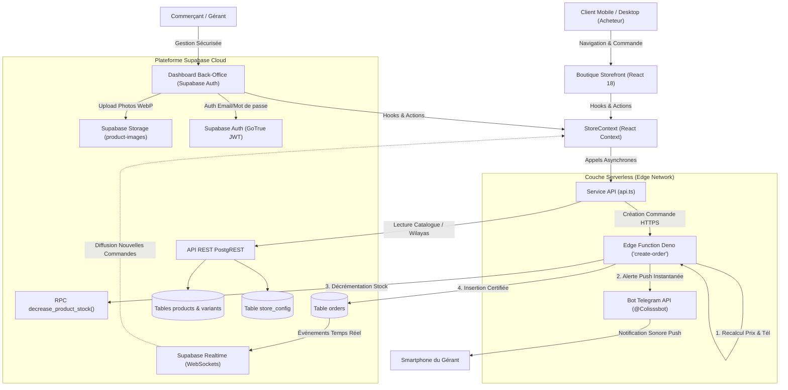
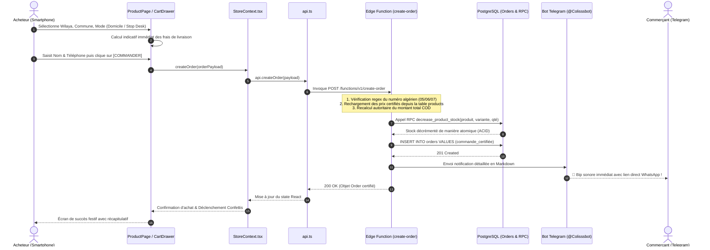
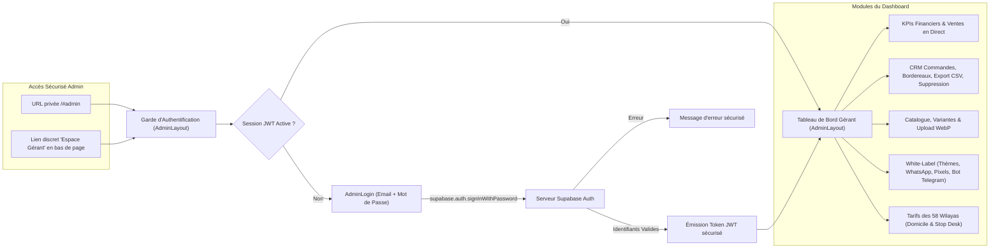

# 02 — Architecture Technique & Diagrammes (Maison Céleste V2)

Ce document décrit l'architecture logicielle du projet **Maison Céleste V2**, les flux de données entre les différents composants, ainsi que les modèles de conception appliqués.

---

## 1. Architecture Globale du Système V2

L'application adopte une **Architecture Hybride Moderne** :
* **Côté Client :** Une Single Page Application (SPA) ultra-réactive développée en **React 18** et **TypeScript**, utilisant le React Context API (`StoreContext`) pour l'état global et un service d'abstraction API (`api.ts`).
* **Côté Serveur Serverless :** Une **Edge Function Supabase (Deno)** `create-order` qui prend en charge les validations critiques (prix, téléphone algérien, décrémentation atomique des stocks, notifications Telegram).
* **Côté Base de Données :** Une instance managée **PostgreSQL 15+** sur **Supabase Cloud** avec politiques de sécurité Row Level Security (RLS) et fonctions RPC.

---

## 2. Flux de Commande Sécurisé V2 (Cash on Delivery)

Le flux de commande intègre une double validation client/serveur pour éliminer toute possibilité de falsification :

---

## 3. Architecture d'Administration & Sécurité de Session V2

L'ancien code PIN côté client a été **intégralement remplacé par Supabase Auth (GoTrue)** :

---

## 4. Stratégie de Résilience & Tolérance aux Pannes (Fail-Safe)

Pour assurer une disponibilité de 99.99 % même en cas de coupure réseau temporaire ou de maintenance cloud :

1. **Tentative Primaire :** Appel de l'Edge Function `create-order` pour validation serveur et décrémentation atomique.
2. **Fallback Secondaire Automatique :** Si l'Edge Function ne répond pas dans le délai imparti, `api.ts` bascule immédiatement sur l'insertion directe sécurisée dans Supabase PostgreSQL avec exécution de la RPC `decrease_product_stock` et envoi de l'alerte Telegram via [`telegramService.ts`](file:///c:/Users/Mohcen/Desktop/maison-celeste-v2/src/services/telegramService.ts).
3. **Fallback Hors-Ligne Tertiaire :** Si la connexion Internet est totalement coupée, la commande est enregistrée dans le cache local et synchronisée dès le rétablissement de la connexion.
