# 06 — Architecture et Conception Frontend (Maison Céleste V2)

Ce document décrit en détail l'organisation frontend de l'application **Maison Céleste V2**, le cycle de rendu, le système de design et la gestion de l'état global.

---

## 1. Arbre des Composants React V2

```mermaid
graph TD
    Root["StoreProvider (StoreContext.tsx)"] --> AppContent["AppContent (App.tsx)"]
  
    AppContent -->|currentView === 'admin'| AdminLayout["AdminLayout.tsx"]
    AppContent -->|currentView !== 'admin'| StorefrontShell["Storefront Shell"]
  
    subgraph "Composants Administrateur (Protégé)"
        AdminLayout --> AdminLogin["AdminLogin.tsx (Supabase Auth Email/Mot de passe)"]
        AdminLayout --> AdminOverview["AdminOverview.tsx (KPIs Financiers & Ventes)"]
        AdminLayout --> AdminOrders["AdminOrders.tsx (CRM Commandes & Statuts)"]
        AdminLayout --> AdminProducts["AdminProducts.tsx (Articles & Upload WebP)"]
        AdminLayout --> AdminShipping["AdminShipping.tsx (Tarifs 58 Wilayas)"]
        AdminLayout --> AdminSettings["AdminSettings.tsx (Thèmes & Bot Telegram)"]
        AdminOrders --> OrderDetailsModal["OrderDetailsModal.tsx"]
        AdminOrders --> OrderDeliverySlip["OrderDeliverySlip.tsx (Bordereau Colis)"]
    end

    subgraph "Composants Boutique Publique"
        StorefrontShell --> Navbar["Navbar.tsx (Logo, Recherche, Panier)"]
        StorefrontShell --> NavigationDrawer["NavigationDrawer.tsx (Menu Mobile)"]
        StorefrontShell --> MainView["Zone Principale Dynamique"]
        StorefrontShell --> Footer["Footer.tsx (Lien discret Gérant)"]
        StorefrontShell --> CartDrawer["CartDrawer.tsx (Panier Latéral)"]
        StorefrontShell --> CartNotification["CartNotification.tsx (Toast Ajout)"]
        StorefrontShell --> CookieBanner["CookieConsentBanner.tsx (RGPD)"]

        MainView -->|'home'| HomePage["HomePage.tsx (Vitrine & Grille 2 colonnes)"]
        MainView -->|'product'| ProductPage["ProductPage.tsx (Fiche Produit + Formulaire COD)"]
        MainView -->|'tracking'| OrderTracking["OrderTracking.tsx (Suivi colis par tél)"]
        MainView -->|'shipping'| ShippingRates["ShippingRates.tsx (Grille Wilayas)"]
        MainView -->|'contact'| ContactPage["ContactPage.tsx (Support client)"]
    end
```

Le point d'entrée [`src/App.tsx`](file:///c:/Users/Mohcen/Desktop/maison-celeste-v2/src/App.tsx) encapsule l'application dans le fournisseur d'état unifié `<StoreProvider>` et gère l'aiguillage entre l'espace public (Storefront) et l'espace privé (Admin).



---

## 2. Gestion de l'État Global ([`StoreContext.tsx`](file:///c:/Users/Mohcen/Desktop/maison-celeste-v2/src/context/StoreContext.tsx))

L'état réactif de l'application est centralisé au sein d'un contexte unique, consommé par les composants via le hook personnalisé `useStore()`.

### 2.1 Principaux États Gérés
* **`currentView` :** Vue active affichée (`home`, `product`, `tracking`, `shipping`, `contact`, `admin`).
* **`products` :** Liste certifiée des produits et variantes rechargée depuis Supabase PostgreSQL.
* **`orders` :** Liste des commandes synchronisée en temps réel via Supabase Realtime et interrogation active.
* **`cart` :** Articles actuellement dans le panier avec gestion des quantités et calcul dynamique des sous-totaux.
* **`isAdminLoggedIn` & `adminUserEmail` :** État d'authentification officiel synchronisé avec les sessions cryptées Supabase Auth (JWT).
* **`isDarkMode` :** Indicateur du mode sombre synchronisé avec la classe HTML `.dark` et le `localStorage`.
* **`incomingNewOrder` :** Dernière commande reçue déclenchant l'alerte sonore et la modale festive.

### 2.2 Synchronisation de Session Supabase Auth
```typescript
// Synchronisation stricte de session Supabase Auth (JWT)
useEffect(() => {
  if (!supabase || !isSupabaseConfigured) return;

  // 1. Vérification de la session active
  supabase.auth.getSession().then(({ data: { session } }) => {
    if (session?.user) {
      setIsAdminLoggedIn(true);
      setAdminUserEmail(session.user.email || null);
    } else {
      setIsAdminLoggedIn(false);
      setAdminUserEmail(null);
    }
  }).catch(() => {
    setIsAdminLoggedIn(false);
    setAdminUserEmail(null);
  });

  // 2. Écoute des changements d'état (login, logout, refresh token)
  const { data: { subscription } } = supabase.auth.onAuthStateChange((event, session) => {
    if (session?.user) {
      setIsAdminLoggedIn(true);
      setAdminUserEmail(session.user.email || null);
    } else {
      setIsAdminLoggedIn(false);
      setAdminUserEmail(null);
    }
  });

  return () => {
    subscription.unsubscribe();
  };
}, []);
```

---

## 3. Système de Design & Moteur de Thèmes Dynamiques

### 3.1 Injection de Variables CSS à Chaud
La fonction `applyThemeVariables()` injecte les codes hexadécimaux de la palette sélectionnée directement sur la racine du document (`document.documentElement.style`) :
* `--store-primary` : Couleur d'accent principale (boutons, icônes phares).
* `--store-primary-hover` : Teinte au survol et focus.
* `--store-secondary` : Couleur d'arrière-plan des badges et conteneurs secondaires.
* `--store-base` : Fond de page général.

### 3.2 Grille Responsive Mobile à 2 Colonnes
Sur mobile, [`HomePage.tsx`](file:///c:/Users/Mohcen/Desktop/maison-celeste-v2/src/components/storefront/HomePage.tsx) utilise une grille CSS responsive :
```html
<div className="grid grid-cols-2 sm:grid-cols-2 md:grid-cols-3 lg:grid-cols-4 gap-2.5 sm:gap-4 md:gap-6">
```
Les cartes de produits sont étudiées pour éviter tout débordement horizontal (`overflow-hidden`), préserver la visibilité des boutons d'action rapide et offrir une zone de clic confortable adaptée aux doigts.

---

## 4. Optimisation des Médias : Compression WebP Client ([`storage.ts`](file:///c:/Users/Mohcen/Desktop/maison-celeste-v2/src/services/storage.ts))

Pour garantir des temps de chargement ultra-rapides sur les réseaux mobiles 3G/4G algériens, l'upload d'images intègre une conversion **WebP** directe :
1. Le fichier image sélectionné par le gérant est chargé dans un élément Canvas HTML5 invisible.
2. L'image est redimensionnée proportionnellement (largeur/hauteur max 1 200 px).
3. Le Canvas exporte un Blob `image/webp` avec un facteur de qualité de 0.82.
4. L'image allégée de 95 % est téléversée sur Supabase Storage.
