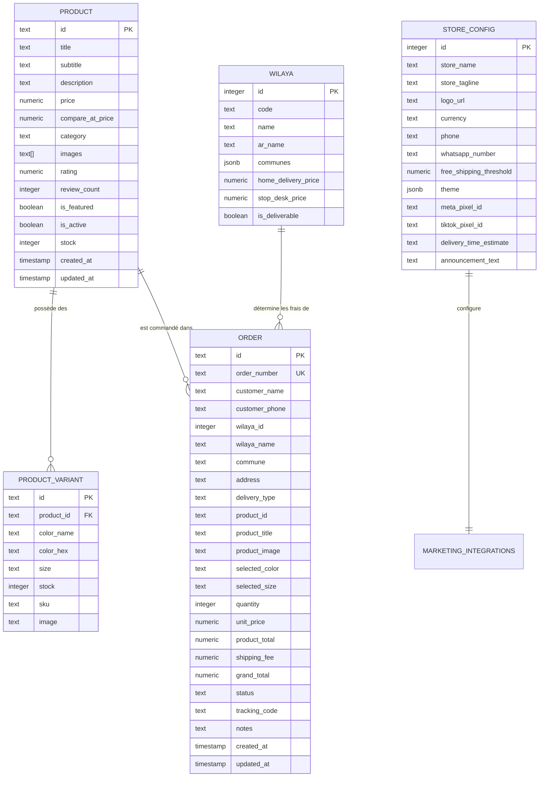

# 08 — Base de Données PostgreSQL & Schéma V2 (Maison Céleste)

Ce document détaille l'intégralité du schéma relationnel de **Maison Céleste V2**, les tables PostgreSQL, les contraintes, les procédures stockées (RPC) et les politiques de sécurité Row Level Security (RLS).

---

## 1. Schéma Entité-Relation Conceptuel V2 (ERD)



---

## 2. Définition des Tables PostgreSQL V2

### 2.1 Table des Commandes (`public.orders`)
```sql
CREATE TABLE IF NOT EXISTS public.orders (
  id TEXT PRIMARY KEY,
  order_number TEXT UNIQUE NOT NULL,
  customer_name TEXT NOT NULL,
  customer_phone TEXT NOT NULL,
  wilaya_id INTEGER NOT NULL,
  wilaya_name TEXT NOT NULL,
  commune TEXT NOT NULL,
  address TEXT NOT NULL,
  delivery_type TEXT NOT NULL DEFAULT 'home', -- 'home' ou 'desk'
  product_id TEXT NOT NULL,
  product_title TEXT NOT NULL,
  product_image TEXT NOT NULL,
  selected_color TEXT,
  selected_size TEXT,
  quantity INTEGER NOT NULL DEFAULT 1,
  unit_price NUMERIC NOT NULL,
  product_total NUMERIC NOT NULL,
  shipping_fee NUMERIC NOT NULL DEFAULT 0,
  grand_total NUMERIC NOT NULL,
  status TEXT NOT NULL DEFAULT 'pending', -- 'pending', 'confirmed', 'processing', 'shipped', 'delivered', 'cancelled'
  tracking_code TEXT,
  notes TEXT,
  created_at TIMESTAMP WITH TIME ZONE DEFAULT TIMEZONE('utc', NOW()),
  updated_at TIMESTAMP WITH TIME ZONE DEFAULT TIMEZONE('utc', NOW())
);

-- Index pour requêtes ultra-rapides
CREATE INDEX IF NOT EXISTS idx_orders_phone ON public.orders (customer_phone);
CREATE INDEX IF NOT EXISTS idx_orders_wilaya ON public.orders (wilaya_id);
CREATE INDEX IF NOT EXISTS idx_orders_status ON public.orders (status);
CREATE INDEX IF NOT EXISTS idx_orders_created_at ON public.orders (created_at DESC);
```

### 2.2 Tables du Catalogue (`public.products` et `public.product_variants`)
```sql
CREATE TABLE IF NOT EXISTS public.products (
  id TEXT PRIMARY KEY,
  title TEXT NOT NULL,
  subtitle TEXT,
  description TEXT,
  price NUMERIC NOT NULL,
  compare_at_price NUMERIC,
  category TEXT NOT NULL,
  images TEXT[] DEFAULT '{}',
  rating NUMERIC DEFAULT 5.0,
  review_count INTEGER DEFAULT 0,
  is_featured BOOLEAN DEFAULT false,
  is_active BOOLEAN DEFAULT true,
  stock INTEGER DEFAULT 0,
  created_at TIMESTAMP WITH TIME ZONE DEFAULT TIMEZONE('utc', NOW()),
  updated_at TIMESTAMP WITH TIME ZONE DEFAULT TIMEZONE('utc', NOW())
);

CREATE TABLE IF NOT EXISTS public.product_variants (
  id TEXT PRIMARY KEY,
  product_id TEXT NOT NULL REFERENCES public.products(id) ON DELETE CASCADE,
  color_name TEXT,
  color_hex TEXT,
  size TEXT,
  stock INTEGER NOT NULL DEFAULT 0,
  sku TEXT,
  image TEXT
);

CREATE INDEX IF NOT EXISTS idx_variants_product_id ON public.product_variants (product_id);
```

---

## 3. Procédure Stockée RPC `decrease_product_stock`

Cette fonction SQL garantit l'atomicité et l'isolation transactionnelle des baisses de stock (évite le sur-vendu) :

```sql
CREATE OR REPLACE FUNCTION public.decrease_product_stock(
  p_product_id TEXT,
  p_variant_id TEXT,
  p_quantity INT
)
RETURNS JSONB
LANGUAGE plpgsql
SECURITY DEFINER
AS $$
DECLARE
  v_current_stock INT;
BEGIN
  -- Verrouillage exclusif de la ligne pour la transaction courante
  SELECT stock INTO v_current_stock
  FROM public.product_variants
  WHERE id = p_variant_id AND product_id = p_product_id
  FOR UPDATE;

  IF v_current_stock IS NULL THEN
    RAISE EXCEPTION 'Variante non trouvée';
  END IF;

  IF v_current_stock < p_quantity THEN
    RAISE EXCEPTION 'Stock insuffisant (disponible: %, demandé: %)', v_current_stock, p_quantity;
  END IF;

  -- Décrémentation de la variante
  UPDATE public.product_variants
  SET stock = stock - p_quantity
  WHERE id = p_variant_id;

  -- Décrémentation du total produit
  UPDATE public.products
  SET stock = GREATEST(0, stock - p_quantity),
      updated_at = NOW()
  WHERE id = p_product_id;

  RETURN jsonb_build_object('success', true, 'remaining_stock', v_current_stock - p_quantity);
END;
$$;
```

---

## 4. Politiques de Sécurité Row Level Security (RLS) V2

La sécurité de la base est assurée par des règles RLS déclaratives :

1. **Table `orders` :**
   * `INSERT` : Autorisé pour tous (`anon` et `authenticated`) afin que n'importe quel visiteur puisse passer commande.
   * `SELECT`, `UPDATE`, `DELETE` : Réservés à l'administrateur authentifié (`TO authenticated`), empêchant les clients de voir les commandes des autres.
2. **Table `products` & `product_variants` :**
   * `SELECT` : Public (`anon`) pour permettre la navigation dans la boutique.
   * `INSERT`, `UPDATE`, `DELETE` : Strictement restreints au rôle `authenticated` (gérant connecté).
3. **Table `store_config` :**
   * `SELECT` : Public (affichage du logo, nom et couleurs).
   * `UPDATE` : Strictement réservé au rôle `authenticated`.
