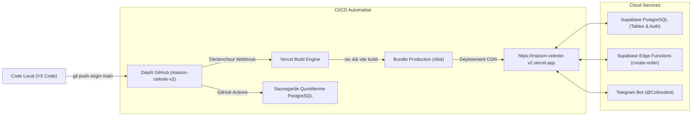

# 12 — Guide de Déploiement en Production (Maison Céleste V2)

Ce document détaille la procédure de déploiement continu de **Maison Céleste V2** sur **Vercel** et **Supabase Cloud**.

---

## 1. Vue d'Ensemble du Pipeline de Déploiement



---

## 2. Déploiement du Frontend sur Vercel

### Étape 1 : Importer le Dépôt GitHub
1. Connectez-vous sur votre compte [Vercel](https://vercel.com).
2. Cliquez sur **Add New...** ➔ **Project**.
3. Sélectionnez le dépôt : **`mouhcenkeffous813/maison-celeste-v2`**.

### Étape 2 : Configuration du Build
* **Framework Preset :** `Vite` (détecté automatiquement).
* **Root Directory :** `./`
* **Build Command :** `npm run build`
* **Output Directory :** `dist`

### Étape 3 : Variables d'Environnement
Dans la section **Environment Variables** de Vercel, ajoutez :
* `VITE_SUPABASE_URL` : `https://omzqajugkhkjxlkfmxpo.supabase.co`
* `VITE_SUPABASE_ANON_KEY` : `sb_publishable_Pi9BqXixbbwCCJDbYZr9bw_HfbiKPSp`
* `VITE_WHATSAPP_PHONE` : `21377526192`
* `VITE_TELEGRAM_BOT_TOKEN` : `9023085999:AAGBO6w0C0jb7w4oiy2j6wqwk782J34mACs`
* `VITE_TELEGRAM_CHAT_ID` : `682438619`

### Étape 4 : Déployer
Cliquez sur **Deploy**. En moins de 45 secondes, votre boutique est en ligne sur son URL officielle avec certificat SSL HTTPS actif.

---

## 3. Déploiement de l'Edge Function Supabase (`create-order`)

Si vous souhaitez modifier ou redéployer l'Edge Function Deno sur Supabase :

```bash
# 1. Se connecter à la CLI Supabase
npx supabase login

# 2. Associer le projet distant
npx supabase link --project-ref omzqajugkhkjxlkfmxpo

# 3. Déployer la fonction create-order
npx supabase functions deploy create-order --no-verify-jwt

# 4. Configurer les secrets de l'Edge Function
npx supabase secrets set TELEGRAM_BOT_TOKEN="9023085999:AAGBO6w0C0jb7w4oiy2j6wqwk782J34mACs"
npx supabase secrets set TELEGRAM_CHAT_ID="682438619"
```

---

## 4. Configuration du Nom de Domaine Personnalisé

Pour connecter votre propre nom de domaine (ex. : `www.maisonceleste.dz` ou `.com`) :
1. Dans le tableau de bord Vercel, allez dans **Settings** ➔ **Domains**.
2. Entrez votre nom de domaine.
3. Configurez les enregistrements DNS chez votre registrar :
   * **Type A :** `@` ➔ `76.76.21.21`
   * **CNAME :** `www` ➔ `cname.vercel-dns.com`
4. Vercel génère automatiquement le certificat SSL Let's Encrypt en quelques minutes.
